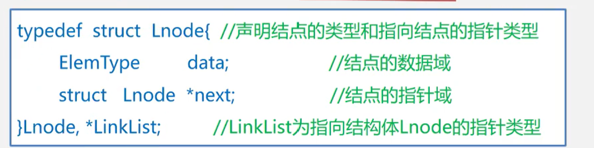
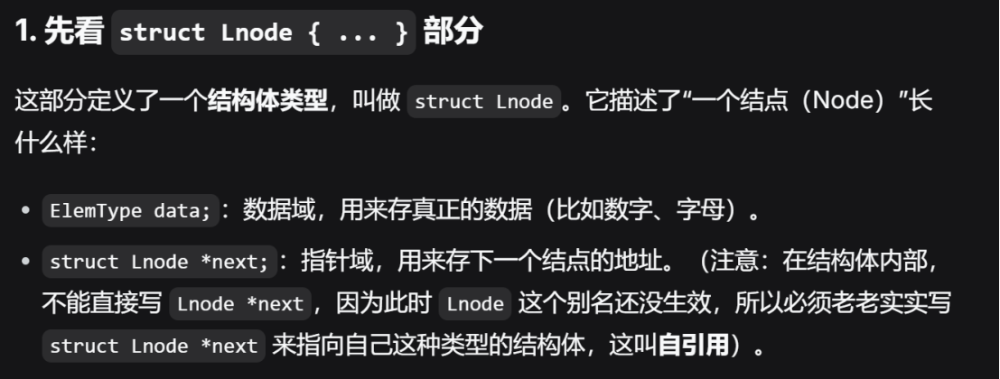
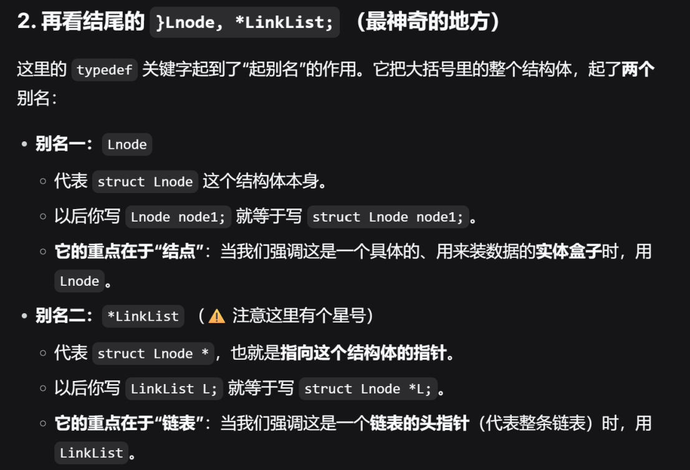
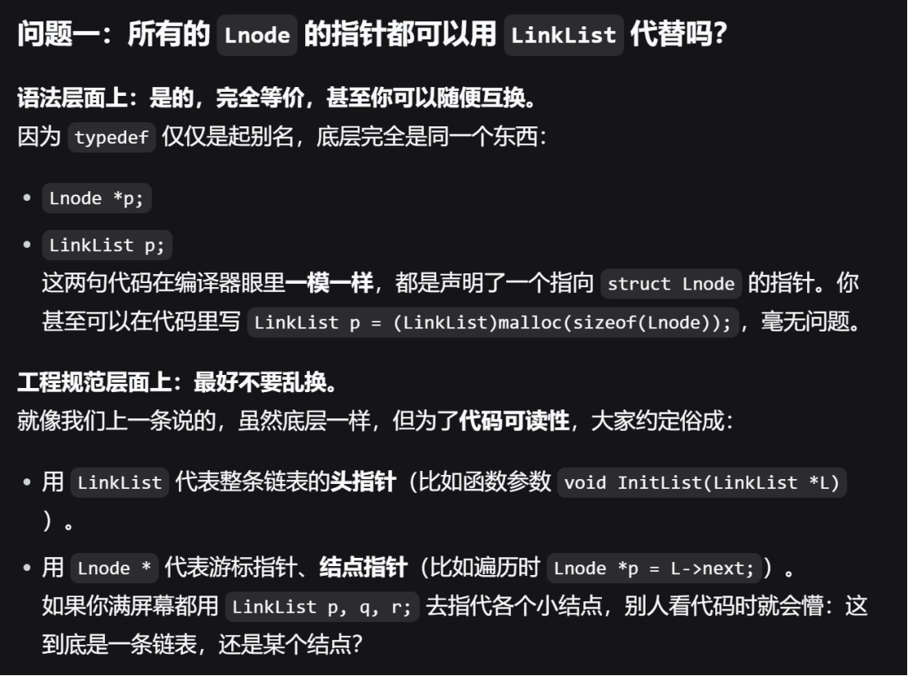
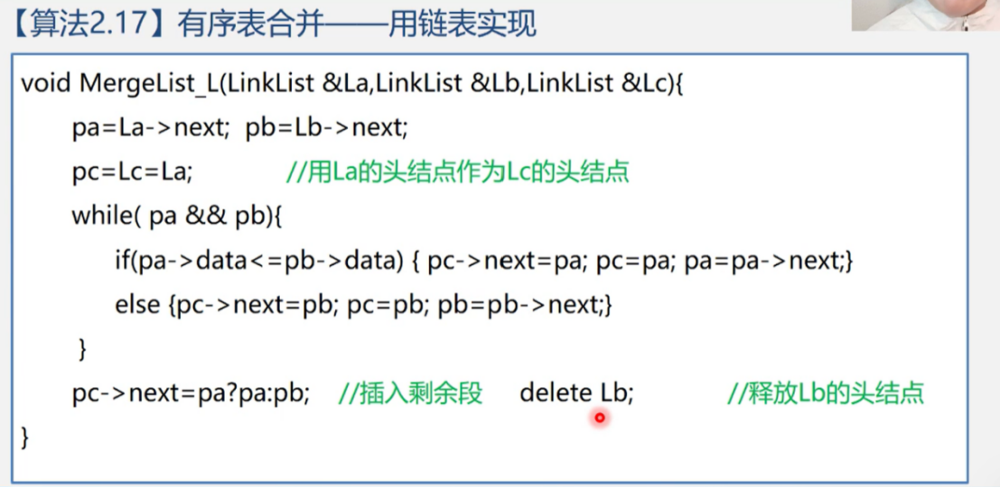
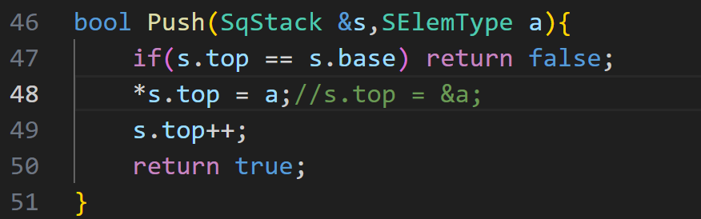
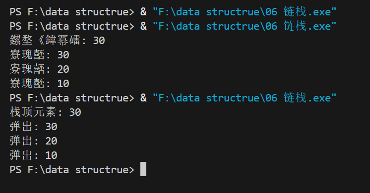
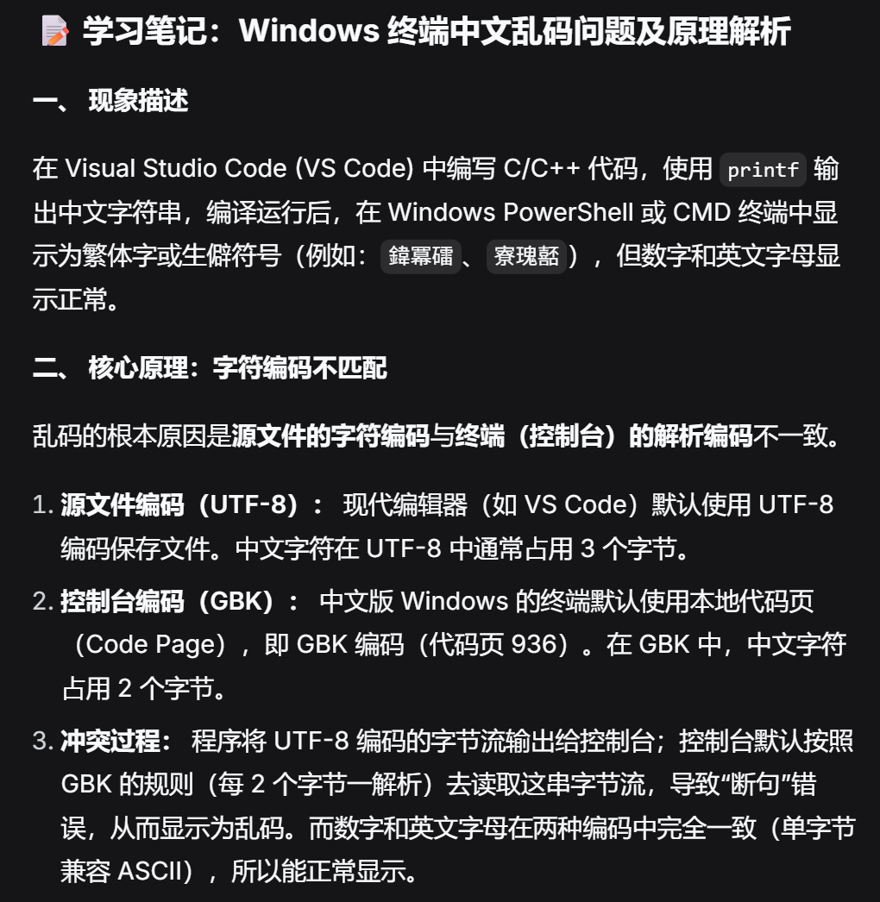
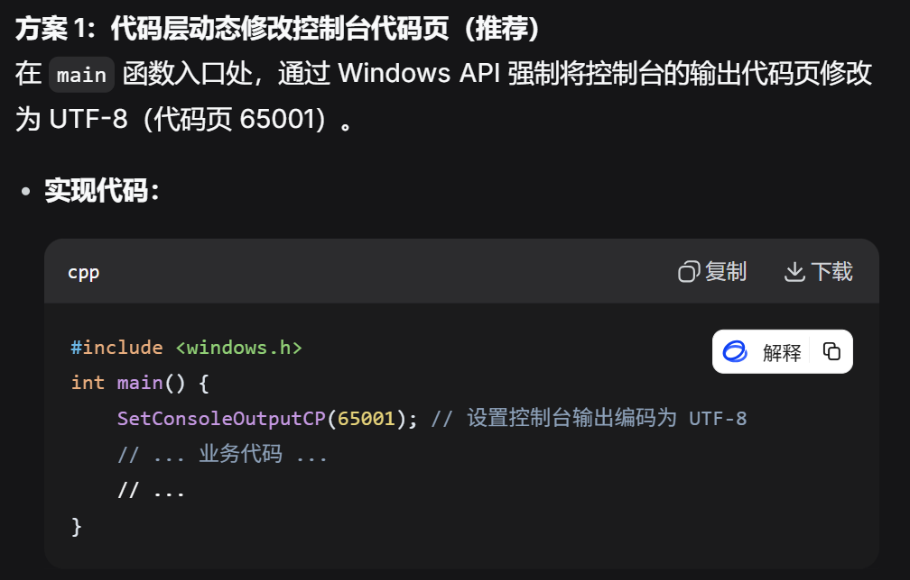

# 链表

  
---

> 所以，所有的Lnode的指针都可以用LinkList代替？内部可不可以改成struct LinkList next?

更规范的写法：typedef Lnode *LinkList;  
推理：*LinkList = Lnode -> LinkList = &Lnode  

---
如果没有头结点，在第一个位置插入或删除元素时，需要修改头指针 head 本身，代码要单独写一段逻辑。有了头结点，在第一个位置插入/删除，就变成了“在头结点后面插入/删除”，和在其他位置操作一模一样，代码大大简化。

---

>好聪明，为什么人能聪明成这样！！   合并单链表

# 栈

## 顺序栈 
简单，方便，但容易溢出（数组大小固定）
- 上溢（overflow）:栈已经满，又要压入元素
- 下溢（underflow）:栈已经空，还要弹出元素
> 上溢是一种错误，使问题的处理无法进行；而下溢一般认为是一种结束条件，即问题处理结束。

---

这里我遇到一个问题：我写的是注释掉的内容，未注释的是老师写的  
1. 如果是前者解引用后赋值，算是拷贝了一份a，而之后修改stack里的内容时与e无关；  
2. 而后者s.top = &a是指针赋值，还会导致stack的结构被破坏：s.top的地址变成a的地址了，之后的内容都存不了  
3. 此外，a是存在函数栈帧里的，当Push函数执行完毕，a的内存会被回收，导致悬空指针（Dangling Pointer）。

## 链栈
链栈是**运算受限**的单链表，只能在**链表头部**进行操作。  
要注意链栈中指针的方向 从顶到底，即从头到尾

- 链表的头指针就是栈顶
- 不需要头结点
- 基本不存在栈满的情况
- 空栈相当于头指针指向空
- 插入和删除仅在栈顶即链表头处执行

> 为什么选择头而非尾？
1. 头插或头删，本身有head指针，在删除/插入时方便，时间复杂度为**O(1)**;若栈顶设为尾，若无尾指针，时间复杂度为**O(n)**.
2. 有了尾指针可以使得入栈变为O(1)，但出栈时，尾指针无法指向其前驱节点(除非使用双向链表，这更费空间了，也更麻烦)
3. 所以，选择头插法最合理，高效 & 节省空间 

>字符乱码,如图所示
  

