# 前言
- 数据结构 = 数据元素 + 数据元素之间的关系
- 抽象数据类型可用（D，S，P）三元组表示。其中： D 是数据对象；S 是 D 上的关系集；P 是对 D 的基本操作集。

# 链表
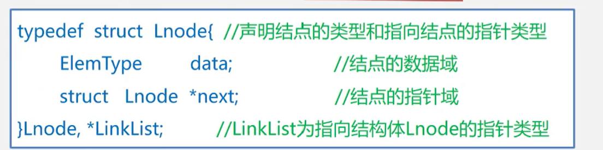
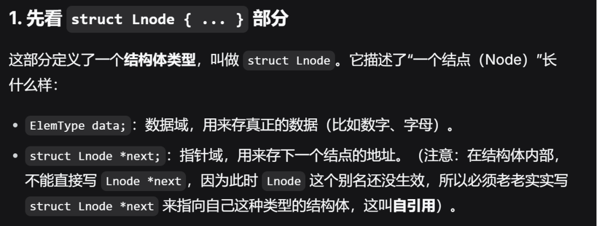
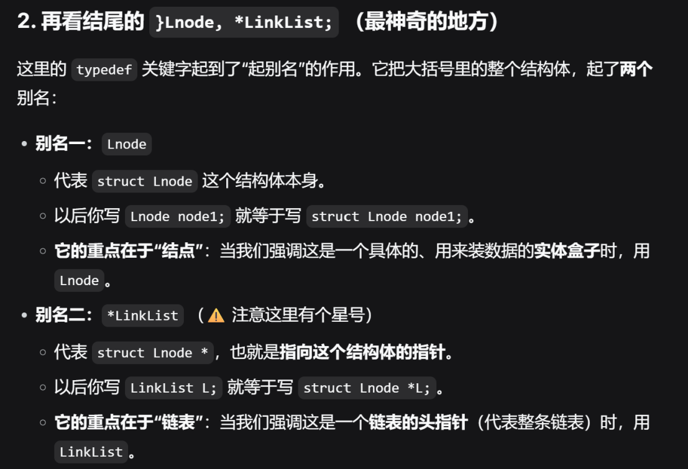

  
---

> 所以，所有的Lnode的指针都可以用LinkList代替？内部可不可以改成struct LinkList next?

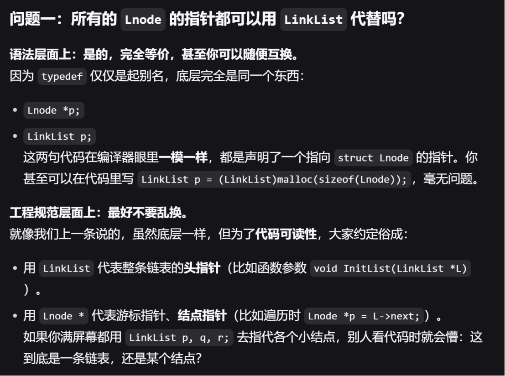

更规范的写法：typedef Lnode *LinkList;  
推理：*LinkList = Lnode -> LinkList = &Lnode  

---
如果没有头结点，在第一个位置插入或删除元素时，需要修改头指针 head 本身，代码要单独写一段逻辑。有了头结点，在第一个位置插入/删除，就变成了“在头结点后面插入/删除”，和在其他位置操作一模一样，代码大大简化。

---

>好聪明，为什么人能聪明成这样！！   合并单链表
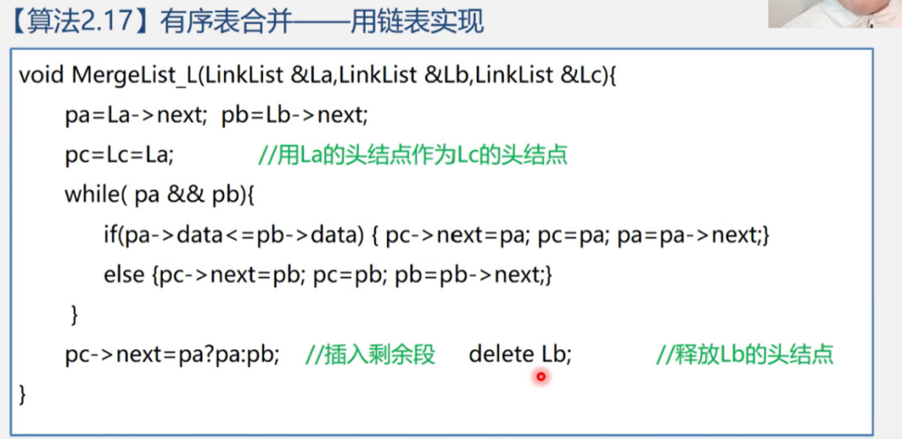
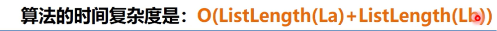
# 栈

## 顺序栈 
简单，方便，但容易溢出（数组大小固定）
- 上溢（overflow）:栈已经满，又要压入元素
- 下溢（underflow）:栈已经空，还要弹出元素
> 上溢是一种错误，使问题的处理无法进行；而下溢一般认为是一种结束条件，即问题处理结束。

---

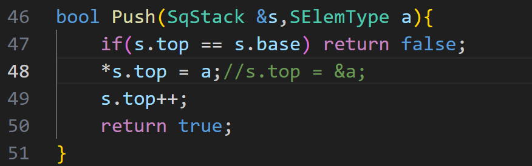
这里我遇到一个问题：我写的是注释掉的内容，未注释的是老师写的  
1. 如果是前者解引用后赋值，算是拷贝了一份a，而之后修改stack里的内容时与e无关；  
2. 而后者s.top = &a是指针赋值，还会导致stack的结构被破坏：s.top的地址变成a的地址了，之后的内容都存不了  
3. 此外，a是存在函数栈帧里的，当Push函数执行完毕，a的内存会被回收，导致悬空指针（Dangling Pointer）。

## 链栈
链栈是**运算受限**的单链表，只能在**链表头部**进行操作。  
要注意链栈中指针的方向 从顶到底，即从头到尾

- 链表的头指针就是栈顶
- 不需要头结点
- 基本不存在栈满的情况
- 空栈相当于头指针指向空
- 插入和删除仅在栈顶即链表头处执行

> 为什么选择头而非尾？
1. 头插或头删，本身有head指针，在删除/插入时方便，时间复杂度为**O(1)**;若栈顶设为尾，若无尾指针，时间复杂度为**O(n)**.
2. 有了尾指针可以使得入栈变为O(1)，但出栈时，尾指针无法指向其前驱节点(除非使用双向链表，这更费空间了，也更麻烦)
3. 所以，选择头插法最合理，高效 & 节省空间 

>字符乱码,如图所示
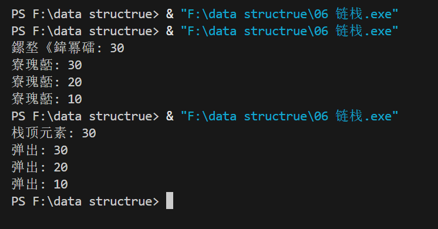  

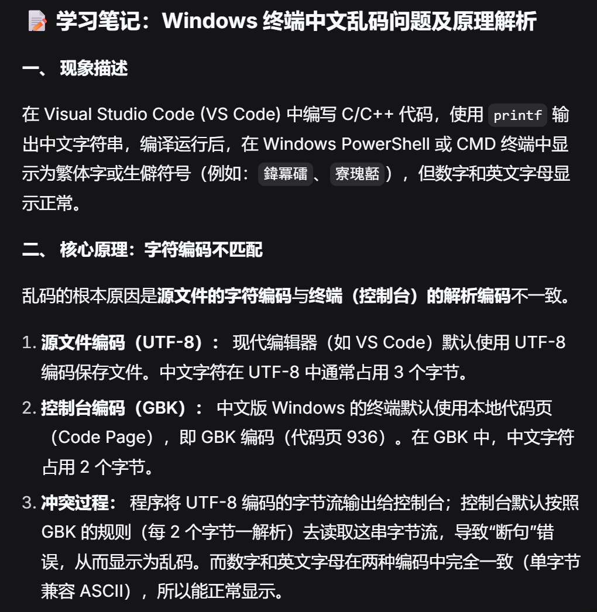
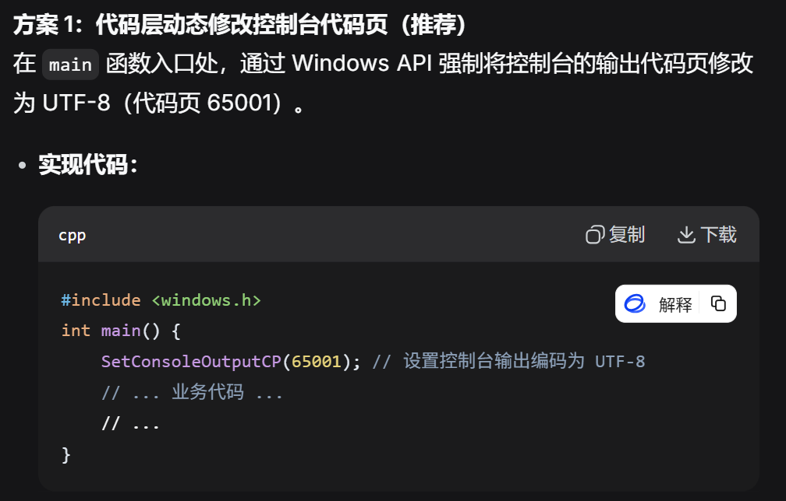

# 串
string---零个或多个任意字符组成的有限序列
### 串的模式匹配算法
> 目的：确定**主串**中所含**子串**(模式串)第一次出现的位置。
1. **BE算法**（Brute-force）又称古典的、经典的、朴素的、穷举的
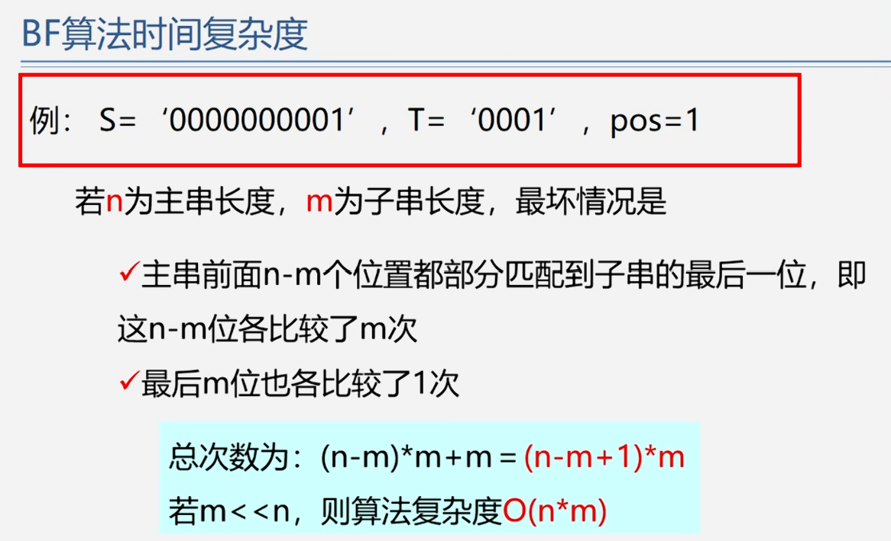
2. **KMP算法** (Knuth Morris Pratt 由发现者姓名命名) 特点：速度快
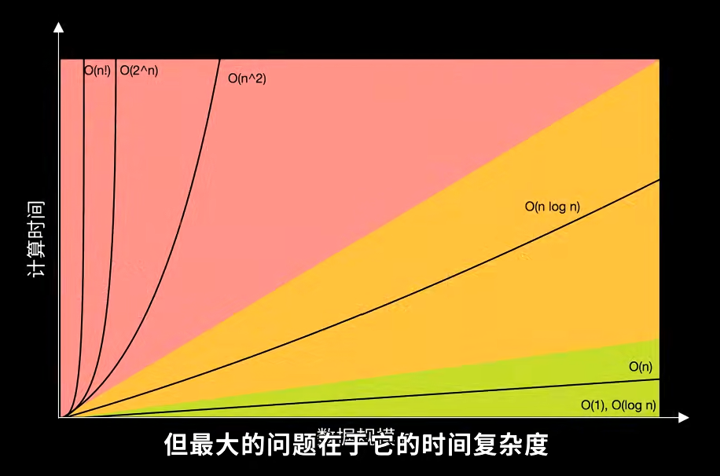

# 数组
声明 ： int num[5][8];
或者在c语言中，一个二维数组类型也可以定义为一维数组类型(其分量类型为一维数组类型)

    typedef elemtype array2[m][n]
==  typedef elemtype array1[n];
    typedef array1 array2[m];

> 线性表结构是数组结构的一个特例，而数组结构又是线性表结构的扩展

- 每个元素占用4个字节，各元素空间上连续 

## 二维数组
- 有两种顺序存储方式
1. 以行为主序，一行一行存; C、JAVA、PASCAL
2. 以列为主序，一列一列存。
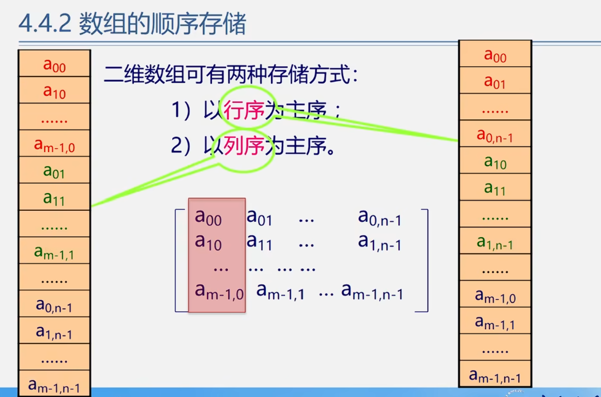

## 三维数组
按页/行/列存放，页优先的顺序存储 

## 压缩存储
若多个数据元素的值都相同，则只分配一个元素值的存储空间，且零元素不占存储空间。eg.对称矩阵、对角矩阵、三角矩阵、稀疏矩阵（矩阵中非0元素过少，一般少于5%）...

### 对称矩阵
- 特点：在n*n的矩阵a中，有a_ij = a_ji (1<=i,j<=n)
- 存储方法：只存储下/上三角（包含主对角线）的数据元素。共占用n*(n+1)/2个元素空间。

### 三角矩阵
- 特点：对角线以下/以上的数据元素（不包含对角线）全部为常数c。前者为上三角矩阵，后者为下三角矩阵。
- 存储方法：重复元素c共享一个元素存储空间，共占用n*(n-1)/2 + 1个元素空间。
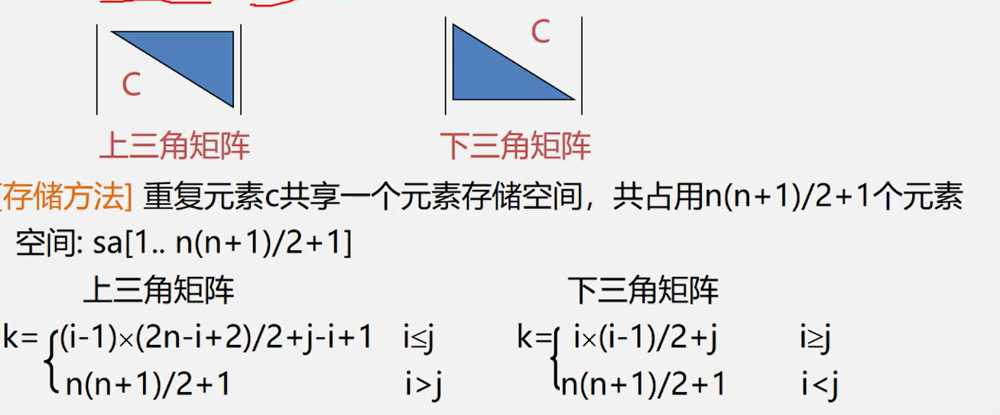

### 对角矩阵
- 特点：在n*n的方阵中，所有非零元素都集中在以主对角线为中心的带状区域中，区域外的值全为0，则称为对角矩阵。常见的有三对角矩阵、五对角矩阵、七对角矩阵。
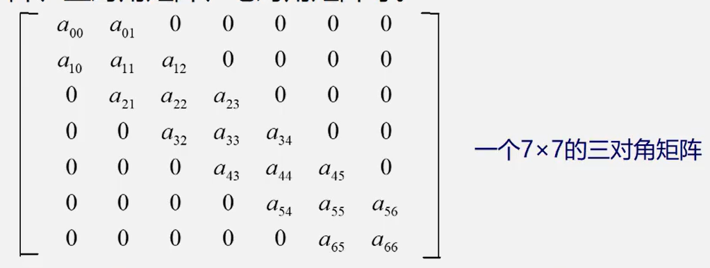

###  稀疏矩阵
- 特点：矩阵中非0元素过少，一般少于5%。

#### 1. 三元组存储
- 可使用三元组存储：(行，列，值)
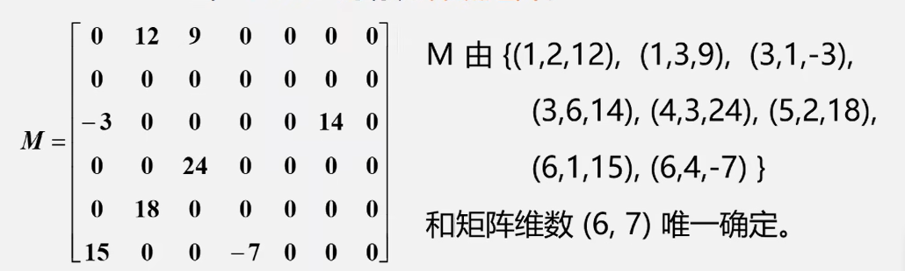
- 为提供更可靠的描述，通常再加一个"总体"信息：即总行数、总列数、非零元素总个数。
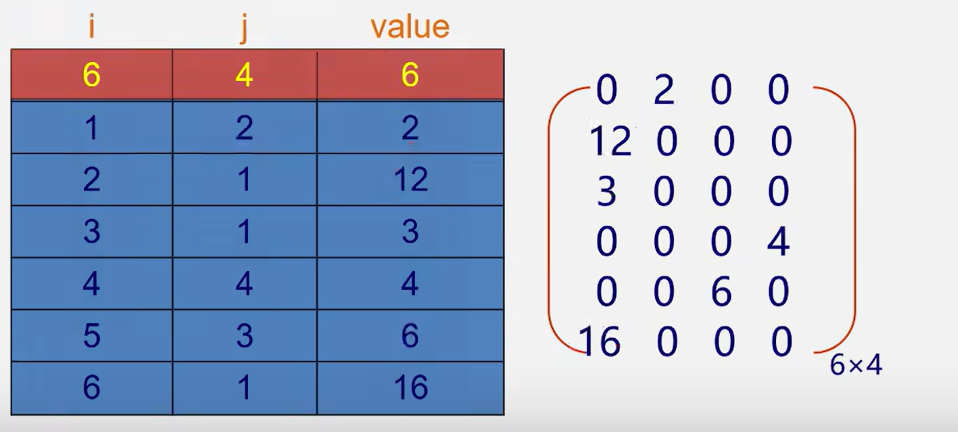

- 三元组顺序表又称有序的双下标法。
- 优点：非零元素在表中按行序有序存储，因此便于进行依行顺序处理的矩阵运算。
- 缺点：不能随机存储。若按行号存取某一行中的非零元，则需要从头开始进行查找。

#### 2. 链式存储：十字链表
- 优点：能够灵活地插入因运算而产生的新的非零元素，删除因运算而产生的新的零元素，实现矩阵的各种运算。
- 在十字链表中，矩阵的每一个非零元素用一个结点表示。该结点除了row、col、value还有两个指针域：
1. right：用于指向同一行中的下一个非零元素；
2. down: 用于指向同一列中的下一个非零元素。
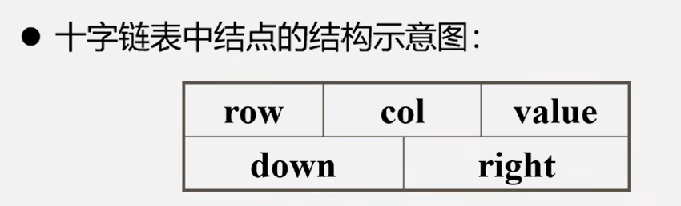
> 此外，十字链表还设有头指针。  

eg.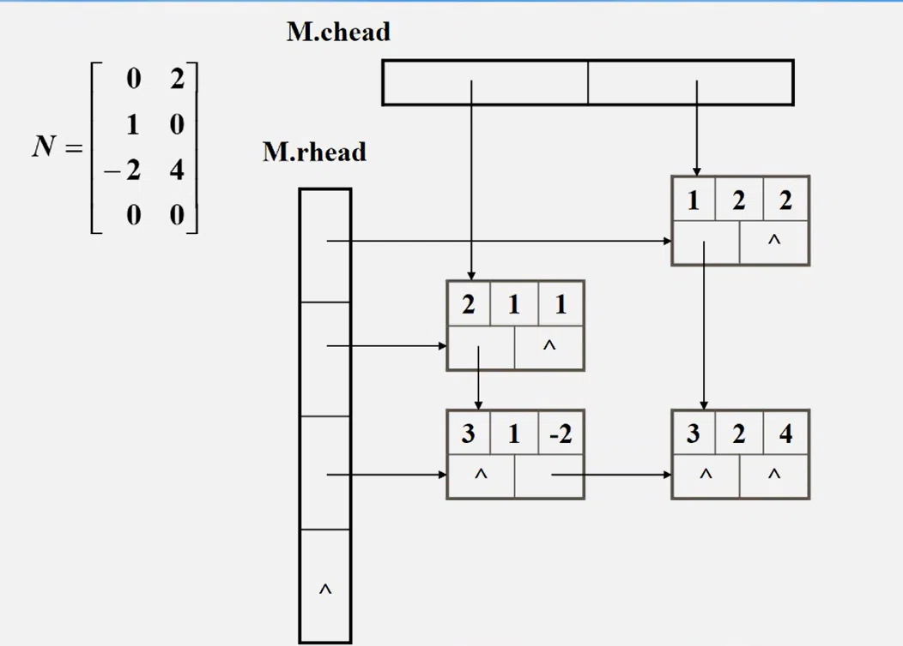
- 一个总头指针，本身是个数组，存放两个指针，一个指向行头指针数组，一个指向列头指针数组。
- 行头指针 M.rhead
- 列头指针 M.chead

# 广义表

广义表，又称列表lists，是n>=0个元素的有限序列，其中每一个a或者是一个**原子**，或者是一个**广义表**。
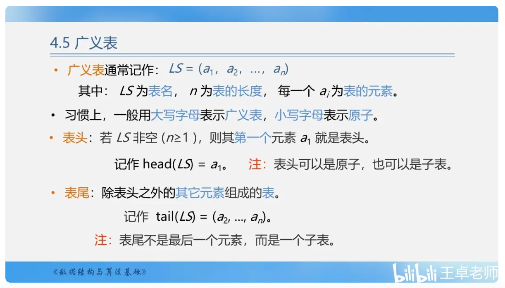
- 区别于线性表：线性表中每个元素必须相同，而广义表的每个元素则可原子/广义表任意二选一。 

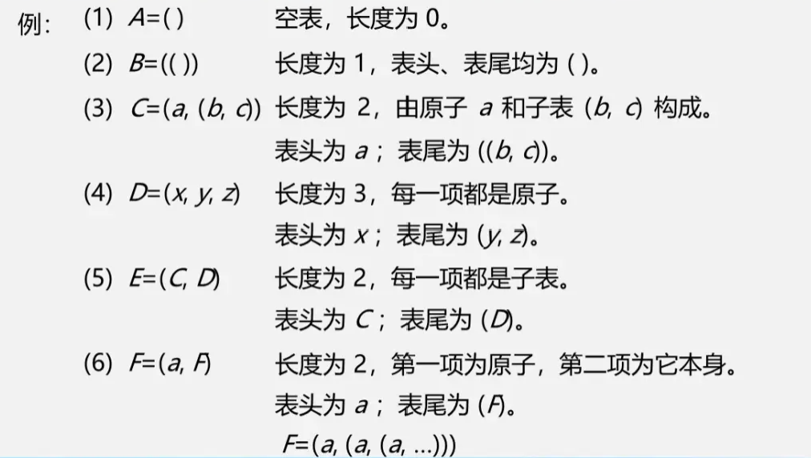
- 广义表的**长度**定义为：最外层所包含元素的个数；
- 广义表的**深度**定义为：该广义表展开后所含括号的重数。eg.原子的深度为0，空表深度为1
- 广义表之间可以相互包含，也可以是一个递归的表
> 注意：
> 1. 递归表的深度是无穷值，长度是有限值
> 2. 表头是单个原子/表，而表尾是一串内容，需要加上括号（）

# 树和二叉树

# 排序
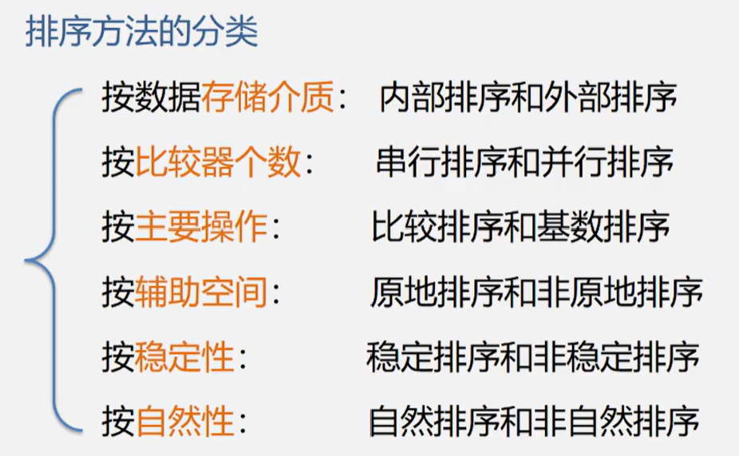

## 插入排序
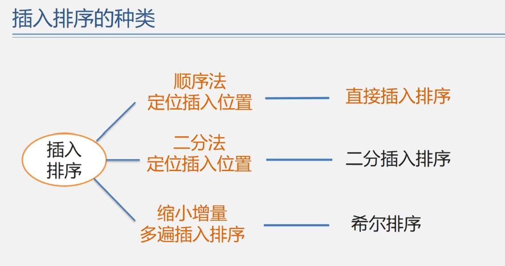
